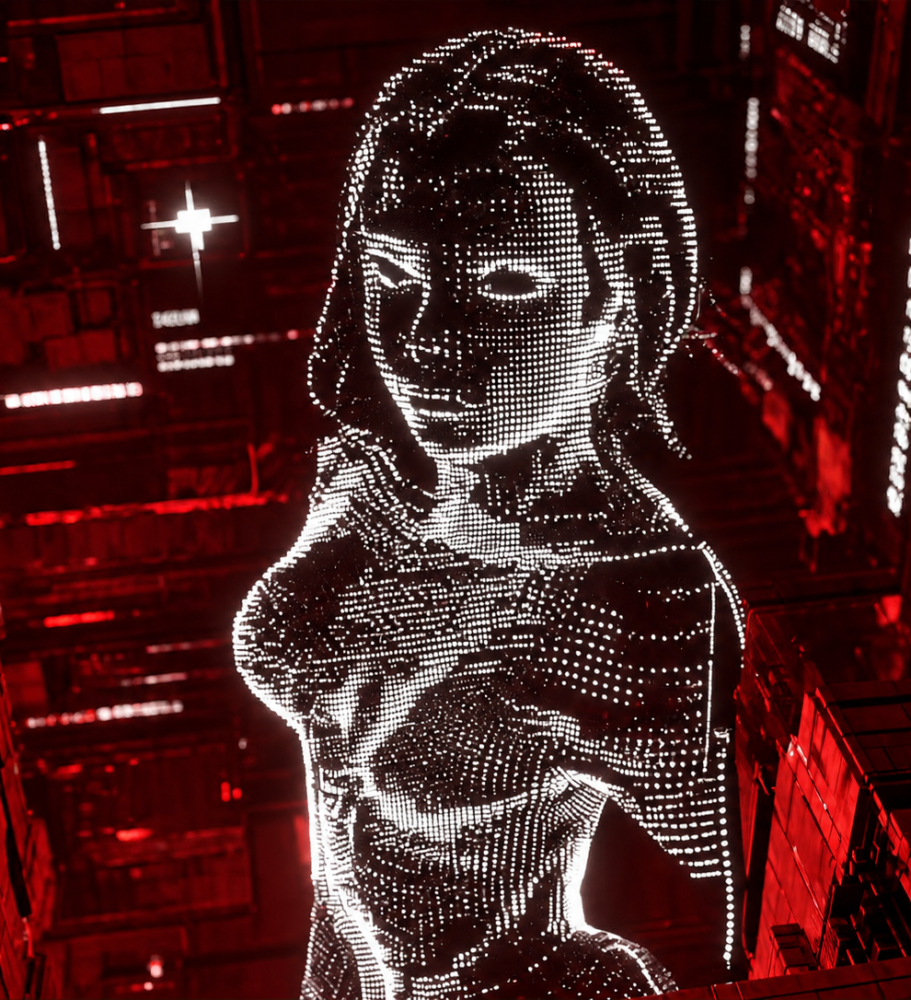

# Mirian Ukeje

### Software Development · Frontend Development · UI/UX Design

*Building thoughtful digital experiences through design and code.*

---

## A Little About My World

  
  

### My GitHub Activity

  

---

## About Me

I'm Mirian Ukeje, a Software Development student at Brigham Young University-Idaho with a passion for front-end development and UI/UX design.

I enjoy designing intuitive interfaces, creating engaging user experiences, and bringing ideas to life through code. I'm continually expanding my software development skills and exploring ways to combine creativity and technology to build meaningful digital experiences.

- Studying Software Development at BYU-Idaho
- Expanding my knowledge of React, Node.js, SQL, APIs, and full-stack development
- Designing intuitive and visually engaging user interfaces using Figma
- Building accessible, responsive, and user-centered web applications
- Working towards becoming a software engineer who solves real-world problems

**Areas I enjoy discussing:** HTML, CSS, JavaScript, responsive web design, Git, GitHub, and UI/UX design.

---

## Technologies & Tools

### Languages

  
  
  
  
  

### Frameworks & Libraries

  
  
  

### Tools & Platforms

  
  
  
  
  

---

## Featured Projects

### 01. Hand Crafted Haven

**Team Project**

A collaborative website for a handcrafted products business. I contributed to the user interface design, focusing on a clean, intuitive, and responsive user experience. I worked alongside my teammates to transform the design into a functional website while collaborating through Git and GitHub.

**Focus:** UI design, responsive layouts, teamwork, and version control.

[View Project Repository](https://github.com/mirianukeje/Handcrafted-Haven)

### 02. Eve | Jewelry Website

A jewelry e-commerce website in development, designed to showcase jewelry pieces through an elegant and visually engaging online experience. The project explores the intersection of frontend development, thoughtful interface design, and digital shopping experiences.

**Focus:** Frontend development, UI/UX design, responsive web design, and e-commerce.

**Status:** In development.

[View Project Repository](https://github.com/mirianukeje/eve)

### 03. Personal Portfolio

A responsive portfolio website showcasing my technical skills, projects, and professional background. Designed, developed, and deployed on Vercel using modern web technologies.

**Focus:** Frontend development, responsive design, and personal branding.

[View Project Repository](https://github.com/mirianukeje/my-portfolio)

### 04. Mood Journal

A digital mood-tracking application designed to help users record their emotions, reflect on their daily experiences, and identify patterns in their moods over time. The project focuses on creating a calm, intuitive, and user-friendly space for personal reflection.

**Focus:** Frontend development, interactive user interfaces, responsive design, and user experience.

[View Project Repository](https://github.com/mirianukeje/mood-journal-new)

---

## Currently Working On

- Strengthening my JavaScript and React skills
- Building responsive and accessible web applications
- Expanding my software engineering portfolio
- Learning backend development with Node.js

---

## Beyond the Code

My interests extend beyond software development. I enjoy writing, exploring design, and finding creative ways to express ideas.

Whether I'm working on an interface, developing an application, or writing an article, I enjoy exploring how creativity and thoughtful problem-solving can turn ideas into something meaningful.

---

## Let's Connect

 

*Made with curiosity, creativity and a little sunshine.*

